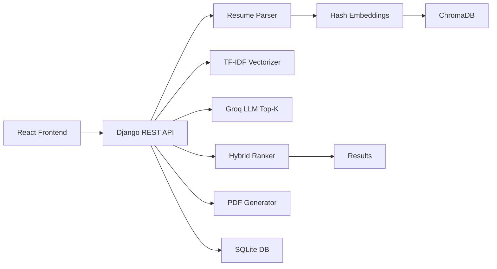

# 🎯 AI Resume Screening Agent v2.0

**Smart, Fast & Accurate Hiring with AI**

A full-stack AI-powered resume screening system that automates candidate ranking using hybrid TF-IDF keyword matching, ChromaDB semantic search, and Groq LLM analysis. Built with Django REST Framework and React with a modern, production-ready architecture.


---

## 🌟 What's New in v2.0

- ✅ **Brand New Home Page** with hero section and workflow visualization
- ✅ **Modern UI** with TailwindCSS (fully responsive)
- ✅ **Top-K LLM Optimization** (analyze only top 3 candidates - 90% cost savings)
- ✅ **Job History System** with search and detailed tracking
- ✅ **PDF Report Generation** for candidates and full screenings
- ✅ **Resume Preview Modal** to view extracted text
- ✅ **Drag-and-Drop Upload** with progress tracking
- ✅ **Top-N Candidate Selector** (dynamic filtering)
- ✅ **Enhanced Results Page** with podium, expandable details, skill badges
- ✅ **Complete Documentation** (Architecture, Setup, Upgrade guides)

---

## 🚀 Features

### **Core Functionality**
- 📝 Create job descriptions with quick-start templates
- 📤 Upload candidate resumes (PDF, DOCX, TXT) with drag-and-drop
- 🧠 AI-powered hybrid ranking:
  - **TF-IDF** keyword matching
  - **Semantic search** via ChromaDB vector database
  - **LLM analysis** via Groq API (top K candidates only)
- 🏆 View ranked results with Top 3 podium display
- 📊 Expandable candidate details with skill matching
- 📋 Complete job screening history
- 📥 Download professional PDF reports
- 👁️ Preview extracted resume text

### **Smart Optimizations**
- ⚡ **Top-K LLM Analysis**: Only analyze top 3 candidates (configurable)
- 🚀 **Hash-Based Embeddings**: CPU-friendly, no GPU required
- 🔍 **Hybrid Scoring**: 60% semantic + 40% keyword
- 📈 **Progress Tracking**: Real-time upload progress bars
- 🎯 **Dynamic Filtering**: Filter top N candidates without API calls

---

## 🏗️ Architecture



**See [ARCHITECTURE.md](./ARCHITECTURE.md) for detailed system design.**

---

## 📦 Tech Stack

### **Backend**
- **Framework**: Django 5.0.4 + Django REST Framework 3.15.2
- **Database**: SQLite (dev) / PostgreSQL (production)
- **Vector DB**: ChromaDB 0.5.3
- **LLM**: Groq API (ChatGroq)
- **ML**: scikit-learn 1.4.2 (TF-IDF)
- **Embeddings**: Custom MD5 hash-based (512-dim, no PyTorch)
- **Docs**: PyPDF 4.2.0, python-docx 1.1.0
- **Reports**: ReportLab 4.0.7
- **LangChain**: 0.3.0 (document loaders, text splitters)

### **Frontend**
- **Framework**: React 19.2.0
- **Routing**: React Router 7.9.6
- **Styling**: TailwindCSS 3.4.0
- **HTTP Client**: Axios 1.13.2
- **Build Tool**: Create React App 5.0.1

---

## ⚡ Quick Start

### **Prerequisites**
- Python 3.10+
- Node.js 18+
- Groq API Key ([Get here](https://console.groq.com))

### **1. Clone Repository**
```bash
git clone <repository-url>
cd resume-screening-agent_6
```

### **2. Backend Setup**
```cmd
cd backend

# Create virtual environment
python -m venv venv
venv\Scripts\activate  # Windows
# source venv/bin/activate  # macOS/Linux

# Install dependencies
pip install -r requirements.txt

# Create .env file
copy .env.example .env  # Windows
# cp .env.example .env  # macOS/Linux

# Edit .env and add your GROQ_API_KEY

# Run migrations
python manage.py migrate

# Create superuser (optional)
python manage.py createsuperuser

# Start server
python manage.py runserver 0.0.0.0:8000
```

### **3. Frontend Setup**
```cmd
cd frontend

# Install dependencies
npm install

# Create .env.local
copy .env.example .env.local  # Windows
# cp .env.example .env.local  # macOS/Linux

# Start dev server
npm start
```

### **4. Access Application**
- **Frontend**: http://localhost:3000
- **Backend API**: http://127.0.0.1:8000/api/screening
- **Admin Panel**: http://127.0.0.1:8000/admin

**See [SETUP.md](./SETUP.md) for detailed installation guide.**

---

## 🎯 Usage Flow

1. **Create Job Description**
   - Navigate to home page
   - Click "Create Job Description"
   - Use template or write custom description
   - Minimum 10 words required

2. **Upload Resumes**
   - Drag-and-drop PDF/DOCX/TXT files
   - Or click "Browse Files"
   - Preview extracted text (optional)
   - Click "Process Resumes"

3. **View Results**
   - See Top 3 podium with medals
   - Adjust "Show Top N" selector
   - Click "View Details" to expand rows
   - Check LLM analysis badges
   - Review matching/missing skills

4. **Access History**
   - Navigate to "History" in navbar
   - Search by job title
   - Click "View Details" for past screenings
   - Download PDF reports

---

## 📊 API Endpoints

```
POST   /api/screening/jobs/                                - Create job
POST   /api/screening/jobs/{id}/resumes/                   - Upload resumes
GET    /api/screening/jobs/{id}/resumes/list/              - List resumes
POST   /api/screening/jobs/{id}/rank/                      - Process screening
GET    /api/screening/resumes/{id}/text/                   - Get resume text
GET    /api/screening/history/                             - List history
GET    /api/screening/history/{id}/                        - Get history details
DELETE /api/screening/history/{id}/delete/                 - Delete history
DELETE /api/screening/history/clear/                       - Clear all history
POST   /api/screening/preview-bulk-email/                  - Preview bulk emails
POST   /api/screening/send-bulk-email/                     - Send bulk emails
GET    /api/screening/history/{id}/download/               - Download full PDF
GET    /api/screening/history/{id}/results/{rid}/download/ - Download candidate PDF
```

---

## ⚙️ Configuration

### **Backend** (`.env`)
```env
# Django
SECRET_KEY=your-secret-key
DEBUG=True
ALLOWED_HOSTS=127.0.0.1,localhost

# Groq LLM
GROQ_API_KEY=your_groq_api_key_here
GROQ_MODEL_NAME=llama-3.3-70b-versatile

# ChromaDB
CHROMA_DB_DIR=chroma_store

# Top-K LLM Optimization (only analyze top K candidates)
MAX_LLM_ANALYSIS=3  # Recommended: 3-5
```

### **Frontend** (`.env.local`)
```env
REACT_APP_API_BASE_URL=http://127.0.0.1:8000/api/screening
```

---

## 🎨 Screenshots

### Home Page
*Modern landing page with hero section, features, and workflow*

### Job Description Page
*Templates, word count, validation*

### Resume Upload Page
*Drag-drop, progress bars, preview modal*

### Screening Results
*Top 3 podium, Top-N selector, expandable details, skill badges*

### Job History
*Search, past screenings, PDF downloads*

---

## 🔐 Top-K LLM Optimization

### **How It Works**
1. Compute **algorithmic scores** (TF-IDF + Semantic) for **ALL** resumes
2. Sort resumes by score (descending)
3. Apply **Groq LLM analysis** to **top K candidates only** (default: 3)
4. Remaining candidates get **algorithmic score only**
5. Display clear badges:
   - ✅ **LLM Analyzed** (green)
   - ⚡ **Algorithm Only** (gray)

### **Benefits**
- **90% cost reduction** for large batches (30+ resumes)
- **3x faster** processing time
- **No accuracy loss** (algorithmic ranking remains accurate)
- **Configurable** via `MAX_LLM_ANALYSIS` setting

### **Example**: 30 Resumes
- **Before**: 30 LLM calls (~60 seconds, high cost)
- **After**: 3 LLM calls (~10 seconds, minimal cost)

---

## 📚 Documentation

- **[ARCHITECTURE.md](./ARCHITECTURE.md)**: Complete system architecture with Mermaid diagram
- **[SETUP.md](./SETUP.md)**: Detailed installation, configuration, and deployment
- **[UPGRADE_SUMMARY.md](./UPGRADE_SUMMARY.md)**: What's new in v2.0

---

## 🧪 Testing

### **Backend Tests**
```cmd
cd backend
python manage.py test screening
```

### **Frontend Tests**
```cmd
cd frontend
npm test
```

---

## 🚀 Production Deployment

### **Quick Checklist**
- [ ] Change `SECRET_KEY` to strong random string
- [ ] Set `DEBUG=False`
- [ ] Update `ALLOWED_HOSTS`
- [ ] Configure PostgreSQL database
- [ ] Set up Nginx reverse proxy
- [ ] Enable HTTPS (SSL certificate)
- [ ] Add authentication (JWT/OAuth)
- [ ] Implement rate limiting
- [ ] Set up monitoring and logging

**See [SETUP.md](./SETUP.md) for complete deployment guide.**

---

## 🐛 Troubleshooting

### **Common Issues**

**1. Port 8000 already in use**
```cmd
# Windows
netstat -ano | findstr :8000
taskkill /PID <process_id> /F

# macOS/Linux
lsof -ti:8000 | xargs kill -9
```

**2. CORS errors**
- Verify backend is running
- Check `REACT_APP_API_BASE_URL` in `.env.local`
- Ensure `CORS_ALLOW_ALL_ORIGINS=True` in Django settings (dev only)

**3. Tailwind styles not applied**
```cmd
cd frontend
npm install
npm start
```

**4. Groq API errors**
- Verify API key in `.env`
- Check quota at https://console.groq.com
- Try different model (`llama-3.1-8b-instant` is faster)

**See [SETUP.md](./SETUP.md) for complete troubleshooting guide.**

---

## 🤝 Contributing

Contributions are welcome! Please:
1. Fork the repository
2. Create a feature branch
3. Make your changes
4. Submit a pull request

---

## 📄 License

This project is open source. Add appropriate license file for your use case.

---

## 🙏 Acknowledgments

- **Groq** for fast LLM inference
- **ChromaDB** for vector database
- **LangChain** for document loaders
- **TailwindCSS** for beautiful styling
- **ReportLab** for PDF generation

---

## 📞 Support

For issues, questions, or feature requests:
- Open a GitHub issue
- Check documentation files
- Review troubleshooting guide

---

## 🎉 Start Screening!

```bash
# Backend
cd backend && python manage.py runserver 0.0.0.0:8000

# Frontend (new terminal)
cd frontend && npm start

# Access at http://localhost:3000
```

**Happy Hiring with AI!** 🚀

---

**Version**: 2.0  
**Last Updated**: December 2024  
**Stack**: Django + React + ChromaDB + Groq LLM
